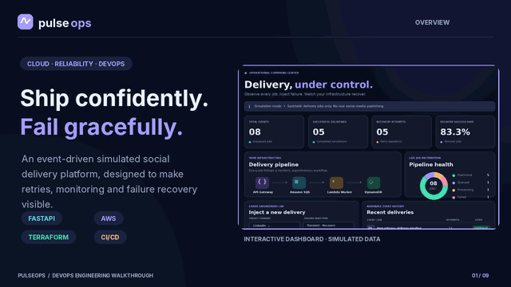
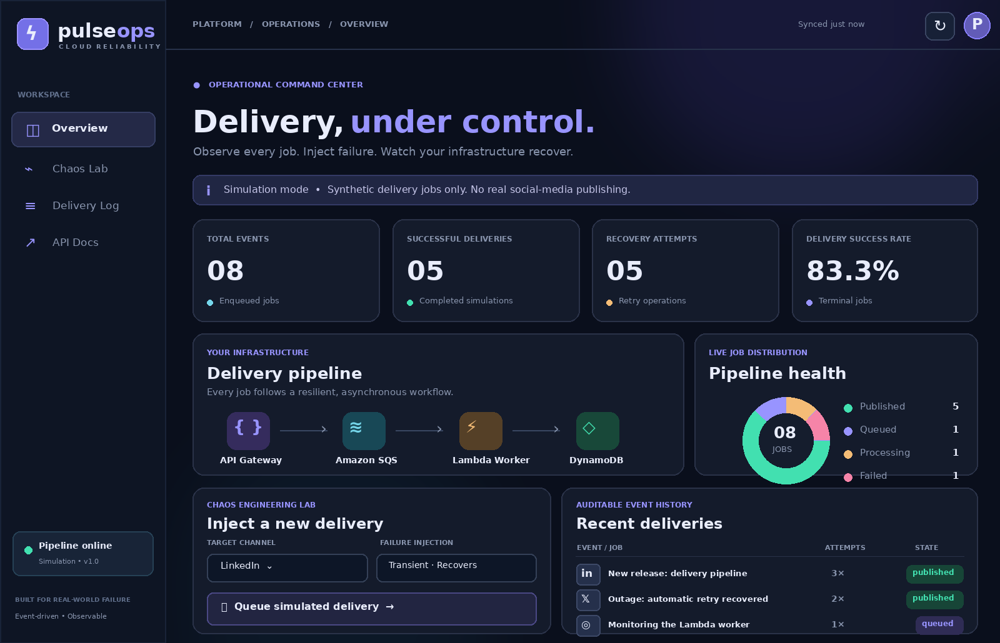
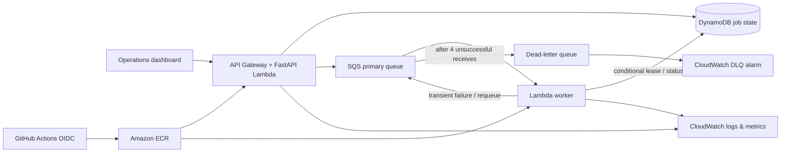

<div align="center">

# ⚡ PulseOps

### An event-driven delivery reliability lab built to *fail gracefully*.

**Python · FastAPI · AWS Lambda · SQS · DynamoDB · Terraform · Docker · GitHub Actions · CloudWatch**

[**Get started locally**](#-run-locally-in-60-seconds) · [**System design**](#-architecture) · [**Cloud deployment**](#-deploy-to-aws) · [**Live demo**](#-5-minute-interview-demo)

[](docs/pulseops-walkthrough.mp4)

**▶ [Watch the 59-second video walkthrough (MP4)](docs/pulseops-walkthrough.mp4)** · [Scene transcript and how to record a live demo](docs/video-walkthrough.md)

*Captioned visual walkthrough of the actual project design and dashboard, using synthetic demonstration data. Not a live AWS deployment recording.*



*Interactive application dashboard. Screenshot uses synthetic demonstration data.*

</div>

## 🎥 Project video walkthrough

Watch the **[59-second PulseOps walkthrough](docs/pulseops-walkthrough.mp4)** to see the dashboard, architecture, failure injection, SQS retries and DLQ behavior, idempotency, GitHub Actions CI/CD, and Terraform infrastructure. The animated preview above is clickable; the full video is kept inside this repository so the README link works after you push to GitHub.

The video is a guided visual presentation, **not a live screen capture of AWS**. For a genuine running-system recording, follow the [live-demo recording instructions](docs/video-walkthrough.md#record-a-live-walkthrough-after-deployment).

## ✨ Why this exists

Publishing a post looks simple until the delivery system has to deal with duplicate submissions, unavailable downstream services, failing workers, retry storms, and messages that cannot be delivered. PulseOps is a practical engineering sandbox for those problems.

The API accepts **simulated** social posts and sends their job IDs to an **SQS queue**. A Lambda worker attempts delivery, writes progress to **DynamoDB**, retries transient errors, and allows permanently failing messages to move to a **dead-letter queue (DLQ)**. **CloudWatch** provides structured logs, metrics, and alarm states. **Terraform** provisions the cloud resources. **GitHub Actions** tests and deploys immutable container images through **OIDC**, with no static AWS credentials in GitHub.

> **Scope:** This is a simulation, not an integration with Hootsuite, LinkedIn, Instagram, or X. It does not publish real posts. Use synthetic content only. Costs may apply to AWS deployment.

## 🏗️ Architecture



### Reliability features

| Failure scenario | Design choice | Where |
|---|---|---|
| User double-clicks submit | `Idempotency-Key`, deterministic job ID, conditional DynamoDB PutItem | `pulseops/store.py` |
| SQS delivers the same event twice | Conditional DynamoDB lease, terminal state check | `pulseops/worker.py` |
| Downstream responds HTTP 503 | SQS/Lambda partial-batch failure response, retry on visibility timeout | `pulseops/worker.py` |
| Poison message / permanent failure | Retry budget of four receives, SQS redrive to a DLQ | `infra/main.tf` |
| One message fails in a successful batch | `ReportBatchItemFailures` avoids retrying the successful messages | `pulseops/worker.py` |
| Worker crashes mid-delivery | DynamoDB lease expires, allowing another worker to retry | `pulseops/store.py` |
| SQS fails during API enqueue | Explicit 503, safely retry *same* idempotency key | `pulseops/api.py` |
| New deployment | Immutable commit-SHA ECR image with GitHub OIDC permissions | `.github/workflows/deploy.yml` |
| Reliability degrades | Embedded Metrics Format, queue depth / DLQ alarm / Lambda telemetry | `pulseops/telemetry.py`, `infra/main.tf` |

> **Engineering honesty:** DynamoDB and SQS are not atomically committed in this sample; an unreachable queue requires client retry with the same key. For production I'd add a transactional outbox or DynamoDB Stream relay, tenant isolation, bounded feed queries, IAM or OAuth authentication, real provider-side idempotency, and paginated query access. `At-least-once` does **not** imply exactly-once external publishing. [Read the tradeoffs](docs/engineering-decisions.md).

## 🚀 Run locally in 60 seconds

**Prerequisites:** Docker Desktop with Compose v2 (Mac, Windows, or Linux).

```bash
# From repository root
docker compose up --build
```

Open **http://localhost:8000** to view the dashboard. In **Demo write key**, enter `demo-local-key` (local setup only). Click **Run chaos demo** to queue five synthetic jobs that exercise successes, retries, and a DLQ case. Data resets when Moto is recreated.

- Interactive UI: `http://localhost:8000/`
- API documentation: `http://localhost:8000/docs`
- Health endpoint: `http://localhost:8000/healthz`
- Local Moto AWS emulator: `http://localhost:5000`

The local environment includes four containers: Moto (AWS simulator), a one-shot resource bootstrap, FastAPI, and the SQS polling worker.

To watch retries:

```bash
docker compose logs -f worker
```

To stop:

```bash
docker compose down
```

## 🧪 Testing

No cloud account, Docker, or Moto installation required for the Python unit tests.

```bash
python3 -m venv .venv
source .venv/bin/activate
pip install -r requirements-dev.txt
ruff check pulseops tests
pytest -q
```

Tests cover API validation/auth, normal publishing, duplicate delivery, idempotency conflict, enqueue failure, transient recovery, permanent failure, poison events, and mixed-success batches. Docker + Moto supplies the integration demo, and cloud smoke testing should follow AWS deployment.

## 🔌 API examples

```bash
curl -X POST http://localhost:8000/api/jobs \
  -H 'Content-Type: application/json' \
  -H 'X-Demo-Key: demo-local-key' \
  -H 'Idempotency-Key: demo-job-001' \
  -d '{"channel":"linkedin","content":"Shipping reliable infrastructure 🚀","failure_mode":"transient"}'

curl http://localhost:8000/api/stats
curl http://localhost:8000/api/jobs
```

Valid failure modes are `none`, `transient`, and `permanent`. Transient mode fails twice and succeeds on attempt three; permanent mode fails on four attempts and becomes eligible for SQS redrive to the DLQ. The delay between retries depends on SQS visibility timeout (6s locally / 180s in AWS), not on arbitrary `sleep()` calls in Lambda.

## ☁️ Deploy to AWS

**Prerequisites:** AWS CLI v2, authenticated AWS CLI profile with permissions to create ECR, Lambda, DynamoDB, SQS, API Gateway, IAM, CloudWatch; Terraform >=1.6; Docker buildx; a GitHub repository. Default region is **`ca-central-1`**.

### 1. Create your GitHub repository

```bash
git init
git branch -M main
git add .
git commit -m "feat: build PulseOps delivery reliability lab"
# Create an empty repository on GitHub, then:
git remote add origin https://github.com/YOUR_USERNAME/pulseops.git
git push -u origin main
```

### 2. One-time: create ECR and push an initial image

```bash
export AWS_REGION=ca-central-1
bash scripts/bootstrap_aws.sh
```

The script prints an **image URI**, for example `123456789012.dkr.ecr.ca-central-1.amazonaws.com/pulseops-delivery:bootstrap`.

### 3. Provision the environment with Terraform

```bash
cd infra
terraform init
terraform plan \
  -var="image_uri=PASTE_ECR_URI_FROM_STEP_2" \
  -var="github_repository=YOUR_USERNAME/pulseops"
terraform apply \
  -var="image_uri=PASTE_ECR_URI_FROM_STEP_2" \
  -var="github_repository=YOUR_USERNAME/pulseops"
terraform output
```

Terraform prompts for `demo_api_key`. Generate a strong value using `python -c 'import secrets; print(secrets.token_urlsafe(32))'`. **Do not paste that key in GitHub, README, terminal history, or Terraform variable files.** Terraform state contains sensitive data, so keep its local state out of Git and securely backed up. For team infrastructure use an encrypted, access-controlled remote state backend.

**Important:** If your AWS account already contains a GitHub OIDC provider, import it into this Terraform state before applying rather than trying to create a second one. See [AWS deployment notes](docs/deployment-notes.md).

The `dashboard_url` output opens your cloud-hosted dashboard. Enter the same key when creating synthetic jobs. **Only deploy into an AWS account you control; AWS is not necessarily free.**

### 4. Configure CD with short-lived AWS credentials

In the repository on GitHub, open **Settings → Secrets and variables → Actions**:

- Repository secret `AWS_DEPLOY_ROLE_ARN`: value from `terraform output -raw deploy_role_arn`.
- Repository variable `ECR_REPOSITORY_URI`: value from `terraform output -raw ecr_repository_uri`.
- If you use the protected `demo` environment, configure its approval rules in **Settings → Environments** (or remove the environment field in the workflow).

The CD workflow builds the Lambda image with `--platform linux/amd64 --provenance=false`, pushes a commit-SHA tag to ECR, and updates both Lambda functions. Deploy with **Actions → CD → Run workflow**, or push to `main` once configured. Role trust only accepts `main` in the exact configured repository. The role cannot modify IAM, your SQS queue, or unrelated Lambda functions.

For code-first changes, pushing to `main` triggers CI and CD as separate workflows; **CD does not currently wait for CI to pass**, so protect `main` with required CI status checks. For production, use a release workflow that gates deployment on verified artifacts and approvals.

### 5. Clean up to stop charges

```bash
cd infra
terraform destroy \
  -var="image_uri=PASTE_ECR_URI_FROM_STEP_2" \
  -var="github_repository=YOUR_USERNAME/pulseops"
cd ..
aws ecr delete-repository --repository-name pulseops-delivery --force --region ca-central-1
```

`terraform destroy` prompts for `demo_api_key` again. Save it securely until teardown. The ECR deletion removes repository images permanently. Confirm the deletion in AWS Console.

## 🎬 5-minute interview demo

1. **Explain architecture (45 sec).** Why SQS decouples ingestion from processing; why DynamoDB stores the authoritative job status.
2. **Submit a healthy job (30 sec).** Show API response `202`, state transitions, and CloudWatch EMF metrics.
3. **Inject a transient failure (60 sec).** Explain that Lambda reports the specific failed message ID; SQS redelivers it after visibility timeout; the third attempt succeeds.
4. **Inject a terminal failure (60 sec).** Show its `failed` state and how the SQS redrive policy eventually places the message in the DLQ.
5. **Replay an idempotency key (30 sec).** Same job ID, no second persistent record; submitting different content with the same key returns HTTP `409`.
6. **Show infrastructure / deployments (60 sec).** Open the Terraform resources, CloudWatch dashboard, and GitHub Actions workflow. Explain tradeoffs and what you'd improve for production.

For a short spoken pitch and suggested responses to tough questions, see [docs/interview-demo.md](docs/interview-demo.md).

## 📁 Repository layout

```text
pulseops/
  api.py                FastAPI app, auth, job endpoints
  worker.py             conditional leases, retries, partial batch response
  store.py              DynamoDB writes, read models, idempotency
  bootstrap.py          initializes Moto AWS emulator
  local_worker.py       SQS worker for docker compose
  lambda_adapter.py     FastAPI → AWS Lambda via Mangum
  telemetry.py          structured logs + CloudWatch EMF
web/                    Responsive operations dashboard
infra/                  Terraform resources and restricted GitHub OIDC role
.github/workflows/      Python CI, Docker/security scan, Terraform, and CD
tests/                  Offline unit tests for API and worker
scripts/                Cloud bootstrap and smoke testing tools
docs/                   Design decisions, deploy notes, interview demo
```

## 🔐 Security and limitations

- Use only synthetic content; public GET endpoints intentionally reveal job content in this *demo*.
- Write requests are protected by `X-Demo-Key`, a demo credential, **not production authentication**.
- AWS CD uses OIDC trust scoped to your repository's `main` branch; no stored AWS access keys.
- The worker and API use separate AWS IAM roles with narrowly scoped data access.
- API Gateway throttling bounds accidental request floods, but does not replace WAF or auth.
- Secrets in Lambda environment variables and local Terraform state require explicit protection; use Secrets Manager or SSM + a managed state backend in production.
- The feed uses DynamoDB `Scan` for a small demo dataset only; use a GSI with pagination at scale.
- Alarms have no notification target by default; connect SNS or your preferred incident tooling when needed.
- This is an engineering showcase, not a production social-media service.

**License:** MIT. See [LICENSE](LICENSE).
